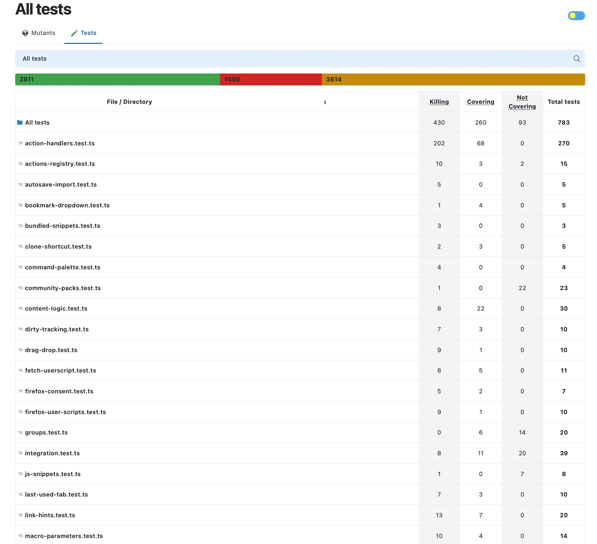
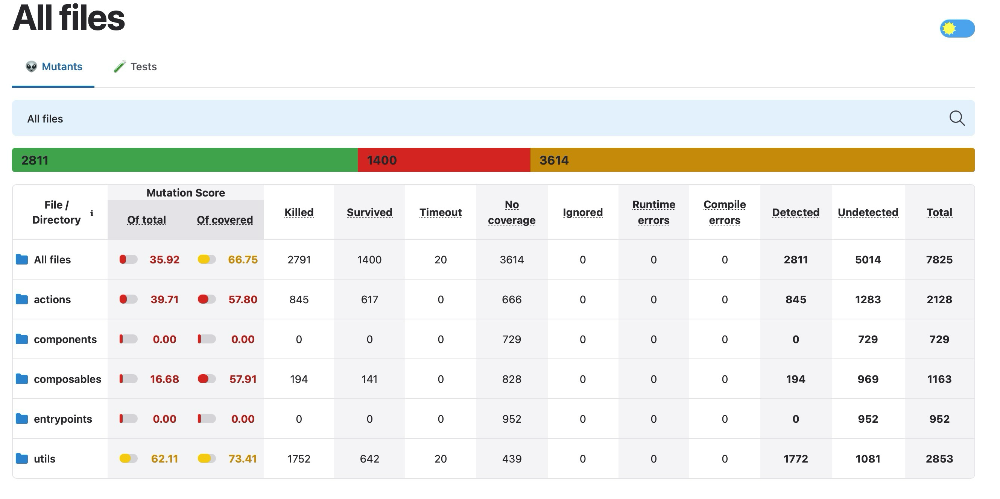

# Group Analysis and Results: Marauroa with PIT
## Identification of the open-source project.
We are testing the project. It is a multiplayer engine written in Java using a TCP oriented network protocol and an SQL based persistence engine. The project spans 26,000 lines of code and builds in 5 seconds from source code using `ant`. 
## Test suite infrastructure
Maraurora uses JUnit for its suite of 143 tests, across 2648 lines of code and takes 7 seconds to execute on a dry run, 4 seconds on subsequent runs.
## Results
| Metric | Numerator / denominator | Result |
|---|---|---|
| Line coverage | 3979 / 12624 | **32%** |
| Mutation score (killed + timeout) | 1533 / 6288 | **24%** |

## Output coverage reports


# Group Analysis and Results: Shortkeys with StrykerJS
## Identification of the open-source project.
[Shortkeys](https://github.com/crittermike/shortkeys) is a TypeScript and Vue 3 browser extension that enables custom keyboard shortcuts for the browser. It spans 13,700 lines of code and takes 8.8 seconds to build from source (806 ms) including the required `npm` packages installation (8 s). 
## Test suite infrastructure
Shortkeys uses Vitest as its testing framework. The unit test suite has 841 passing tests in 34 files and takes 1.26 s to run. The e2e tests are not included.
## Results

| Metric | Result |
|---|---|
| Line coverage | 1369 / 3079 = 44.46% |
| Mutation score (killed + timeout) | 2811 / 7825 = 35.92% |
| Mutation score on covered code | 2811 / 4211 = 66.75% |

Of the 7825 mutants, 2791 were killed, 20 timed out, 1400 survived and 3614 had no coverage. Both tools cover every `.ts` and `.vue` file under `src/`.

| Directory | Line coverage | Mutation score |
|---|---|---|
| `src/utils` | 598 / 777 (77.0%) | 1772 / 2853 (62.1%) |
| `src/actions` | 568 / 728 (78.0%) | 845 / 2128 (39.7%) |
| `src/composables` | 202 / 586 (34.5%) | 194 / 1163 (16.7%) |
| `src/components` | 0 / 489 | 0 / 729 |
| `src/entrypoints` | 0 / 498 | 0 / 952 |
## Output coverage reports
### Test report


### Mutant report


## How do your results from PIT and Stryker compare?
TODO
## What do the results tell you about your test suite?
The PIT report shows that the most tested aspects of the project are `marauroa.common.[game\net]` because they have the most amount of coverage. The reason is that since Marauroa is an online engine, it makes sense that the most tested code is spent on the network and game logic side, rather than testing the database or IO interactions.

The Stryker report for chromekeys shows that `actions` and `utils` are the most tested components in the project and each have a reasonable, but not great, mutation score. The `components` and `entrypoints` directories weren't even tested because they're mostly UI.
## Which system did you find easier to use (both integrate and interpret) and why?
**Stryker**, setup is confined within the project. It doesn't need additional dependencies on the machine unlike with PIT where you need OpenJDK etc. Stryker is project specific
## Do the test suites exhibit weaknesses? How can they be improved?
### PIT
The overall PIT report shows 32% line coverage and a 24% mutation score, so many paths are either untested or insufficiently checked. The database package's separate report located in `mutation-results-db/index.html` is somewhat better at 46% line coverage, but its mutation score is only 22% (141 of 651 mutants), indicating that many behavioral changes still go undetected. The networking results are also uneven. Although `marauroa.common.net` has 73% line coverage and a 58% mutation score, the client and server network packages have 0% line and mutation coverage in the main report.

These gaps could be improved by adding deterministic database integration tests such as tests to verify persistence, transaction, and error-handling behavior. For networking, it could be improved by adding focused tests for client/server connection lifecycles, timeouts, disconnects, malformed input etc. Across both areas, the improved tests should assert observable outcomes rather than only execute code.
### Stryker

About a third of the code, the Vue components and the entrypoints, is never run by a unit test.

Some tests check copies of the code instead of the code itself. `injected-functions.test.ts` and `shortcut-recorder.test.ts` import nothing from `src/`, and `groups.test.ts` uses its own grouping helpers, so `useGroups.ts` has 1.28% line coverage.

Many tests run code without checking the result. `action-handlers.ts` has 80.2% line coverage but a 39.2% mutation score, and 611 of the 1400 survivors. Its tests often only check that something was called or that the handler returned true, and the browser mocks ignore their arguments.

To improve the suite, the copied functions should be tested directly, assertions should check exact values, mocks should check their arguments, and the untested composables need tests. Not every survivor is worth fixing: 607 are changed string or boolean literals, many of them UI labels.

## Do the test suites exhibit strengths? How do you recognize them?
### PIT
The strengths of the test suite can be seen in `marauroa.common.game` with 80% line coverage, 58% mutation coverage and a test strength of 71%. Its 58% mutation coverage also shows that the tests detect many meaningful behavioral changes. Another strong area is a part of the network code in `marauroa.common.net`, with 73% line coverage, 60% mutation score, and 80% test strength. In its class breakdown, `Encoder` and `EncoderDecoderTest` each show 100% line and mutation coverage, suggesting the encoder behavior and its tested round-trip cases are checked thoroughly. 

These strengths are easy to recognize with the strong amount of coverage by the tests conducted, compared to the rest of the test coverage report, where most of the line and mutation coverage is at 0%.
### Stryker

Small modules with pure logic are tested well, for example `useViewDensity.ts` (100%), `content-logic.ts` (96.8%) and `useUndoRedo.ts` (93.2%). The suite is strong where code is easy to isolate and weak where it touches the browser or the UI.

## Contrast the costs and benefits of mutation analysis and testing versus what you might expect from other techniques.
### PIT
**Costs**: Mutation testing with PIT took about 1 minute 10 seconds for the run excluding the database tests and 88 seconds for the run including the database and connection tests. This is more time than a normal test run ex. `ant test` because PIT repeatedly modifies the program and runs tests against those modified versions. The reports also take time to interpret as surviving mutants need reviewing since they can indicate missing assertions and also be equivalent to the original code.

**Benefits**: Mutation testing provides more insight as it reveals whether tests detect small behavioral changes as compared to line coverage which only shows whether some code ran. Additionally, compared with a regular JUnit run, PIT helps identify tests that pass without checking outcomes effectively. Its results also help prioritize areas for improvement such as showing stronger coverage in marauroa.common.game from other weaker less tested areas. 
### Stryker
**Costs and benefits**

The full Stryker run took 13 min 16 s, compared with about 5 seconds for the tests with coverage. Checking 1400 survivors by hand was not practical, so we did not remove equivalent mutants, and 35.92% is a lower bound.

Mutation testing shows whether the tests would catch a fault, not just whether code ran, and each survivor points to a specific missing check. Coverage is much cheaper and is the better first step, since it already finds the 3614 mutants in code that never runs.

## What was easy and what was difficult about applying the tools to the projects you chose?
### PIT
The easy part was compiling and testing the project once we got PIT setup. The hard part was getting PIT to work on our machines. Since Marauroa uses `ant` to build, we had to get the correct `pitest` jars from the GitHub repo. Which meant we needed to compile `pittest` itself and move the jars to the `libs/` directory in Marauroa. Then we had to downgrade some libraries used by Marauroa after reading all the error logs. We also encountered issues where the build for PIT testing would fail since we didn't have a compatible environment for it and it was difficult to locate the root cause. We had to go through different possibilities on what might be failing such as looking into incompatible Java versions or missing packages such as OpenJDK since the build failure messages were hard to interpret with the sheer amount of information printed out.
### Stryker
Setup was easy because Stryker supports Vitest directly. The hard parts were that Stryker does not report line coverage, so we needed a second tool, and that the project-wide numbers had to be broken down by file before we could act on them.


## What obstacles did you face in applying mutation analysis to a real world project, and how did you overcome them?
### PIT
We encountered compatibility issues because the project used an older JUnit version than the one expected by our PIT setup. Additionally, some database tests also failed under PIT even though the regular test run worked. We discovered that the tests share a static singleton state, including `TransactionPool` and `DAORegister`, and PIT can run tests in a different order or rerun them while analyzing mutants. This shared state made the database tests sensitive to execution order. To work around this, we had to create a separate PIT target for the database tests and generated a dedicated report for them.
### Stryker

Our first coverage run gave 66.23% (1367 / 2064). Vitest had left out the .vue files, because the project's test config has no Vue plugin, and it also excluded the entrypoints. 

We added `vitest.coverage.config.js`, which uses the Vue plugin and the same files as Stryker. This brought the result to 44.46%.

Stryker also only mutates the script part of Vue files, so template bugs are not covered.

## Did you have any other interesting insights or opinions on the experience?
(Viktor) It was interesting running the tests on this project which is an online game server, so as a user I wouldn't suspect how many interactions between components make the multiplayer game run. The fact that the mutation coverage is low may be a sign that the tests haven't been updated too often or they didn't take this approach into consideration when they were writing them.

(Melody) It was interesting to see just how weak the test coverage for smaller areas of the program is with what looks like half being 0% line and mutation coverage. even though the main areas are well tested, it would definitely help with having some deterministic tests on networking and database as they are still an important area of the project overall

(Zheyuan) Two Stryker runs on the same code gave slightly different scores (35.88% and 35.92%), because the number of timeouts in link-hints.ts changed. We used the second run. With 841 passing tests the project looks well tested, but only about a third of the mutants are killed.


(Saud Imtiyaz) Writing explicit inputs and expected outcomes made those weaknesses concrete. I also learned that surviving mutants require investigation rather than automatic classification as bugs. Checking reports carefully mattered too, because excluded tests and overlapping runs affected interpretation. Overall, mutation testing helped me think more critically about what assertions actually prove.

# Individual Analysis and Results
## Zheyuan Analysis
### Individual Analysis: selectTab

I picked `selectTab(direction)` in `src/actions/action-handlers.ts` (lines 20-54). It is behind five shortcuts: next tab, previous tab, first tab, last tab and go to tab N. 

```typescript
async function selectTab(direction: string): Promise<void> {
  const tabs = await browser.tabs.query({ currentWindow: true })                          // 21
  if (`tabs.length <= 1`) return                                                            // 22
  const [currentTab] = await browser.tabs.query({ currentWindow: true, active: true })    // 24
  const currentIndex = tabs.findIndex((t) => `t.id === currentTab.id`)                      // 25
  let target
  switch (direction) {
    case 'next':     target = tabs[(`currentIndex + 1`) `% tabs.length`]; break               // 30
    case 'previous': target = tabs[(`currentIndex - 1` `+ tabs.length`) `% tabs.length`]; break // 33
    case 'first':    target = tabs[0]; break
    case 'last':     target = tabs[tabs.length - 1]; break                                // 39
    default: {
      const index = parseInt(direction) || 0                                              // 42
      if (index >= 1 && index <= tabs.length) target = tabs[index - 1]                    // 43
    }
  }
  if (target?.id) await browser.tabs.update(target.id, { active: true })                  // 49-50
}
```

I ran Stryker only on this method, using `stryker.selecttab.config.json` (before) and stryker.`selecttab.after.config.json` (after). Each run takes about 10 seconds. The configs, the reports and the test changes (`selectTab-tests.patch`) are in `shortkeys-individual/`.

### How many mutants killed? How many mutants are live?

Stryker made 50 mutants for this method.

| | Killed | Survived | No coverage | Score |
|---|---|---|---|---|
| Before | 10 | 19 | 21 | 10/50 = 20% |
| After my tests | 46 | 4 | 0 | 46/50 = 92% |

The 4 survivors left are equivalent (see below), so excluding them the score is 46/46.

The 21 uncovered mutants surprised me. The suite already has tests called handles action: firsttab, lasttab and gototabbyindex, but they all mock a window with a single tab, so `selectTab` returns at line 22 and the first/last/index code never runs.

### For every mutant that was not killed, determine either (a) that it is an equivalent mutant that should not be killed, or (b) how to add a test to kill it

1. Next tab: `currentIndex + 1` changed to `currentIndex - 1`. Killed before and after.
2. Previous tab: `% tabs.length` changed to `* tabs.length`. Killed before and after.
3. The guard `tabs.length <= 1` changed to `tabs.length > 1`. Killed before and after.
4. The guard `tabs.length <= 1` changed to `tabs.length < 1`. Survived before, killed after.
5. Previous tab: `currentIndex - 1` changed to `currentIndex + 1`. Survived before, killed after.
6. Previous tab: `+ tabs.length` changed to `- tabs.length`. Survived before, killed after.
7. Finding the current tab: `t.id === currentTab.id` changed to `t.id !== currentTab.id`. Survived before, killed after.
8. The first query: `{ currentWindow: true }` changed to `{}`. Survived before, killed after.
9. Last tab: `tabs.length - 1` changed to `tabs.length + 1`. No coverage before, killed after.
10. Go to tab N: `index >= 1` changed to `true`. No coverage before, still survives after because it is equivalent.

Before: 3 killed, 7 live, score 3/10 = 30%. After: 9 killed, 1 equivalent, score 9/10 = 90% (9/9 without the equivalent one).

Mutants 1, 2 and 3 were already killed by the existing tests, so I left them as they were.

For mutants 5 and 7, I changed the existing next and previous tab tests to check which tab is activated, not just that one is.

For mutant 6, I added a test that starts on the first tab, goes to the previous tab, and expects the last tab.

For mutant 8, I added a test that checks the arguments passed to tabs.query.

For mutant 9, I added a test with three tabs that expects firsttab to pick tab 1 and lasttab to pick tab 3.

For mutant 4, I added a test that a window with one tab gets no tabs.update call.

Mutant 10 is equivalent. For an index below 1, `tabs[index - 1]` is undefined in JavaScript, so nothing happens, which is the same as the original. I added tests for positions 0, 4 and abc, and it still survives.

### Other unkilled mutants and duplicates

Three other mutants on line 43 are equivalent for the same reason: `index <= tabs.length` changed to `true`, the whole condition changed to `true`, and `&&` changed to `||`. Line 49 already ignores a missing target, so the range check on line 43 is redundant.

The mutant that changes `index >= 1` to i`ndex > 1` is not equivalent, because it breaks go to tab 1. I added position 1 to the tests to kill it.

Mutant 4 and the mutant that replaces the same guard with false are duplicates, since a window always has at least one tab. The four equivalent mutants on line 43 are also duplicates of each other.

### Challenges

The hardest part was deciding equivalence, which needed reasoning about negative array indexes, `parseInt` and the sign of `%`. Some mutants, like mutant 6, only fail on one specific input, and I missed the `index > 1` mutant the first time.

### Conclusion

The method is correct, but its tests were weak. They checked that a tab was activated but not which one, used a single tab that never got past the guard, and used mocks that ignore their arguments. With 9 new tests and 2 stronger ones, the score went from 20% to 92%, and the only survivors left are equivalent.
## Melody Analysis
### Project: [chrome-shortkeys](https://github.com/Atune-D/cmpt473-a3-shortkeys)

**Method chosen:** `utils\url-matching.ts::normalizeUrlPattern` **analysed with Stryker**
```ts
export function normalizeUrlPattern(pattern: string): string {
  if (/^\/.+\/$/.test(pattern)) return pattern
  if (pattern.includes('*')) return pattern
  return `*${pattern}*`
}
```
**Original line:** 

`export function normalizeUrlPattern(pattern: string): string {function body}`

**Mutant 1:** 

`export function normalizeUrlPattern(pattern: string): string {}`
- BlockStatement
- Change: `function body` &rarr; `empty function body {}`
- Killed

**Original line:**

`if (/^\/.+\/$/.test(pattern)) return pattern`

**Mutant 2:**

 `if (true) return pattern`
- ConditionalExpression
- Change: `if (/^\/.+\/$/.test(pattern))` &rarr; `if (true)`
- Killed

**Mutant 3:** 

`if (false) return pattern;`
- ConditionalExpression
- Change: `if (/^\/.+\/$/.test(pattern))` &rarr; `if (false)`
- Killed

**Mutant 4:** 

`if (/^\/.\/$/.test(pattern)) return pattern`
- Regex
- Change: `/^\/.+\/$/` &rarr; `/^\/.\/$/`
- Killed

**Mutant 5:** 

`if (/\/.+\/$/.test(pattern)) return pattern`
- Regex
- Change: `/^\/.+\/$/` &rarr; `/\/.+\/$/`
- Survived

**Mutant 6:** 

`if (/^\/.+\//.test(pattern)) return pattern`
- Regex
- Change: `/^\/.+\/$/` &rarr; `/^\/.+\//`
- Survived

**Original line:**


`if (pattern.includes('*')) return pattern`

**Mutant 7:** 

`if (true) return pattern`
- ConditionalExpression
- Change: `if (pattern.includes('*'))` &rarr; `if (true)`
- Killed

**Mutant 8:** 

`if (false) return pattern`
- ConditionalExpression
- Change: `if (pattern.includes('*'))` &rarr; `if (false)`
- Killed

**Mutant 9:** 

`if (pattern.includes("")) return pattern`
- StringLiteral
- Change: `pattern.includes('*')` &rarr; `pattern.includes("")`
- Killed

**Original line:**


`` return `*${pattern}*` `` 

**Mutant 10:**  

`return `` `
- StringLiteral
- Change:  `` return `*${pattern}*` `` &rarr; `return `` `
- Killed

### How many mutants killed? How many mutants are live?
Out of the 10 chosen, 8 were killed and 2 survived.

### For every mutant that was not killed, determine either (a) that it is an equivalent mutant that should not be killed, or (b) how to add a test to kill it

Both of the surviving mutant are not equivalent mutants that should not be killed.

- **Mutant 5** doesn't check the start of the regular expression. It accepts and returns strings that end with `/` even when they do not start with `/`. In this case, adding a test such as `normalizeUrlPattern("prefix/a/")` will have the mutant return `prefix/a/`, instead of the expected `*prefix/a/*`, killing it.
- **Mutant 6** doesn't check the end of a regular expression. It accepts and returns a string that starts with a `/` even if it doesn't end with `/`. Adding a test such as `normalizeUrlPattern("/a/b")` will have the mutant return `/a/b` instead of the expected `*/a/b*`, killing it.

Since the project uses Vitest, these Vitest tests use the described inputs and expected output as the oracle:

```ts
describe('normalizeUrlPattern tests', () => {
  it('require start with slash if end with slash', () => {
    expect(normalizeUrlPattern('prefix/a/')).toBe('*prefix/a/*')
  })

  it('require end with slash if start with slash', () => {
    expect(normalizeUrlPattern('/a/b')).toBe('*/a/b*')
  })
})
```

The first test kills mutant 5, and the second kills mutant 6.

### For all mutants, try to determine whether they are duplicates of each other. What are the challenges involved? Does it affect the results?

Mutants **2, 7, and 9** are duplicates: each return `pattern` for every input. Mutant 9's `pattern.includes("")` condition is always considered true, just like the unconditional `true` conditions in mutants 2 and 7. They can all be killed by the same tests.

A challenge to determining duplicates is comparing outputs over the entire relevant input domain, not just comparing the mutant itself. For this function, the three duplicate mutants can be grouped together as they all have the same behaviour as `if (true)` at the same point in time at the function. More complex functions may require more careful path analysis or equivalence checking. When duplicates are found, it does affect the results, such as the end mutation score. When calculating the mutation score, you'll need to subtract the duplicates, however, if none are found then the mutation score can be calculated as 'normal'.

### Calculate and report the mutation score / effectiveness for your particular mutants. What do these results say about the effectiveness of the test suite and the method(s) that you considered?

The mutation score for the 10 selected mutants without counting in the duplicates is **8 / 10 = 80%**. If the duplicates (mutants 2, 7, and 9) are counted as one mutant, then the new mutation score is: 6 are killed and 2 survive, for a score of **6 / 8 = 75%**.

The tests detect most of the selected changes, but they miss two important regex-boundary cases. Adding the two test cases from above would improve the coverage of those boundaries. However, these results are only limited to this selected set of mutants for one method and doesn't represent the effectiveness of the projects entire test suite.


## Viktor Analysis
### Project: Marauroa
**Method chosen**: `src/marauroa/common/net/Decoder.java` analyzed with PIT.
```java
public List<Message> decode(Object channel, byte[] data) throws IOException,
        InvalidVersionException {
  MessageParts buffers = content.get(channel);

  if (buffers == null) {
    /* First part of the message */
    /*
      * We need to be *sure* that 4 bytes are at least to
      * be received...
      */
    if(data.length<4) {
      throw new IOException("Message is too short. Missing mandatory fields.");
    }

    int size = getSizeOfMessage(data);

    if(size<0) {
      throw new IOException("Message size is negative. Message ignored.");
    }

    if (data.length == size) {
      /* If we have the full data build the message */
      Message msg = msgFactory.getMessage(data, 4);
      List<Message> list=new LinkedList<Message>();
      list.add(msg);

      return list;
    } else {
      logger.debug("Message full body missing ("+size+"), waiting for more data ("+data.length+").");
      /* If there is still data to store it. */
      buffers = new MessageParts();
      content.put(channel, buffers);
    }
  } else {
    logger.debug("Existing data, trying to complete Message full body");
  }

  buffers.add(data);
  List<Message> list = new LinkedList<Message>();

  while (!buffers.isEmpty()) {
    Message msg = buffers.build();

    if (msg != null) {
      list.add(msg);
    } else {
      if (list.isEmpty()) {
        return null;
      }
      return list;
    }
  }

  content.remove(channel);

  return list;
}
```
**Line:**

`if (buffers == null) {...}`

**Mutant 1:**

1. negated conditional &rarr; KILLED
- **Type**: NEGATED_CONDITIONALS

**Line:**
`if(data.length<4) {...}`

**Mutants 2 and 3:**
1. changed conditional boundary &rarr; SURVIVED
- **Type**: CONDITIONALS_BOUNDARY
2. negated conditional &rarr; KILLED
- **Type**: NEGATED_CONDITIONALS

**Line:**
`if(size<0) {...}`

**Mutants 4 and 5:**
1. negated conditional &rarr; KILLED
- **Type**: NEGATED_CONDITIONALS
2. changed conditional boundary &rarr; KILLED
- **Type**: CONDITIONALS_BOUNDARY

**Line:**

`if (data.length == size) {...}`

**Mutant 6:**

1. negated conditional &rarr; KILLED
- **Type**: NEGATED_CONDITIONALS

**Line:**

`return list;`

**Mutant 7:**

1. replaced return value with `Collections.EmptyList` &rarr; KILLED
- **Type**: EMPTY_RETURNS

**Line:**

`logger.debug("Message full body missing ("+size+"), waiting for more data ("+data.length+").");`

**Mutant 8:**

1. removed call to `marauroa/common/Logger::debug` &rarr; SURVIVED

**Line:**

`logger.debug("Existing data, trying to complete Message full body");`

**Mutant 9:**

1. removed call to `marauroa/common/Logger::debug` &rarr; KILLED

**Line:**

`buffers.add(data);`

**Mutant 10:**

1. removed call to `marauroa/common/net/Decoder$MessageParts::add` &rarr; KILLED

### How many mutants killed? How many mutants are live?
Out of 10 mutants, 8 were killed and 2 survived.
### For every mutant that was not killed, determine either (a) that it is an equivalent mutant that should not be killed, or (b) how to add a test to kill it
#### Mutant 2: `< 4` changed to `<= 4`
a) This mutant is not equivalent because a test can tell the two inputs apart. The reason it survived is because no test sends exactly 4 bytes. 

b) We could add a test that sends exactly a 4 byte header that says the message is longer than 4 bytes. The original code will wait for more data and the mutant throws an error.

```java
assertNull(Decoder.get().decode(new Object(), new byte[]{100, 0, 0, 0}));
```

#### Mutant 8: `logger.debug` removed
This mutant is equivalent because the presence/absence of a debug log is indistinguishable from the original program. 

This mutant could be killed by checking the log output and comparing against "Message full body..."
### For all mutants, try to determine whether they are duplicates of each other. What are the challenges involved? Does it affect the results?
Since no two mutants behave exactly the same on every input, there are no duplicates among the 10. If anything, mutants 4 and 5 overlap because of the condition change. 

The biggest challenge in determining identical mutants is that we can't prove it just by reading the code. We'd have to work through them by hand to check.

This affects the results in that killed duplicates make the score look better than it is. Surviving equivalent mutants make it look worse than it is.

### Calculate and report the mutation score / effectiveness for your particular mutants. What do these results say about the effectiveness of the test suite and the method(s) that you considered?
The mutation score for the 10 mutants is 80% (8/10). If the duplicates are counted as one mutant then it's 89% (8/9)

The tests are mostly good at catching negated conditions and wrong return values, but miss the 4 byte boundary check for `decode`. The error cases (message too short, negative size) are never actually run. The mutants on those conditions were killed only because flipping them breaks normal inputs, so the score looks better than the real testing of those error cases.


## Saud Imtiyaz Analysis
### Individual analysis — Marauroa Attributes

`fill(Attributes attr)` replaces the destination object's state using a source object. It copies the RPClass and modified flag, clears and copies the current-content map and the added/deleted tracking maps, and returns the destination object. This is a stateful routine: correctness depends on replacing existing state consistently across several maps. Populated destinations and nonempty source change records are particularly useful cases to investigate. The selected mutations do not test every aspect of this method, including concurrency behavior.

PIT generated eight mutants for `fill`. To reach the required ten, two mutants were selected from the related method `applyDifferences(Attributes addedChanges, Attributes deletedChanges)`. That method removes requested attributes except `id` and `zoneid`, then applies added/updated values. Its null checks, protected identifiers, and update order provide additional behavior to consider.

### Ten selected mutants

The following outcomes were reproduced in a targeted PIT run against the existing tests before adding any new tests. Each row describes a separate mutant. Source-level changes below explain PIT bytecode mutations; the source files were not manually changed.

| ID | Method / line | PIT operator | Original | Mutated behavior/code | Outcome |
|---|---|---|---|---|---|
| M1 | `fill` / 76 | `VoidMethodCallMutator` | `setRPClass(attr.rpClass);` | `call removed` | SURVIVED |
| M2 | `fill` / 79 | `VoidMethodCallMutator` | `content.clear();` | `call removed` | SURVIVED |
| M3 | `fill` / 81 | `VoidMethodCallMutator` | `content.putAll(attr.content);` | `call removed` | KILLED |
| M4 | `fill` / 84 | `VoidMethodCallMutator` | `added.clear();` | `call removed` | SURVIVED |
| M5 | `fill` / 86 | `VoidMethodCallMutator` | `added.putAll(attr.added);` | `call removed` | SURVIVED |
| M6 | `fill` / 89 | `VoidMethodCallMutator` | `deleted.clear();` | `call removed` | SURVIVED |
| M7 | `fill` / 91 | `VoidMethodCallMutator` | `deleted.putAll(attr.deleted);` | `call removed` | SURVIVED |
| M8 | `fill` / 94 | `NullReturnValsMutator` | `return this;` | `return null;` | SURVIVED |
| M9 | `applyDifferences` / 896 | `NegateConditionalsMutator` | `deletedChanges != null` | `deletedChanges == null` | KILLED |
| M10 | `applyDifferences` / 907 | `VoidMethodCallMutator` | `put(attrib, addedChanges.get(attrib));` | `call removed` | KILLED |

### Behavioral effect of each mutation

- **M1:** The destination retains its previous RPClass instead of taking the source class.
- **M2:** Keys present only in the destination can remain after copying.
- **M3:** Source content is not copied; destination content has already been cleared.
- **M4:** Stale destination addition records can remain.
- **M5:** Source addition records are not copied; the destination addition map has been cleared.
- **M6:** Stale destination deletion records can remain.
- **M7:** Source deletion records are not copied; the destination deletion map has been cleared.
- **M8:** The method returns null instead of the destination object, although copying still runs.
- **M9:** A non-null deletion set is skipped; a null deletion set enters iteration and can throw NullPointerException.
- **M10:** Added or updated attribute values are not applied through this call.

### Evidence for killed mutants

- **M3:** PIT identifies `marauroa.common.game.RPObjectDelta2Test.testSlotObjectAddition` as the killing test.
- **M9:** PIT identifies `marauroa.common.game.RPObjectDelta2Test.testApplyDifferences` as the killing test.
- **M10:** PIT identifies `marauroa.common.game.GetAndApplyDifferencesTest.addedAttributeRPObject` as the killing test.

### Survivor investigation and implemented tests

Seven JUnit 4 tests were added in `AttributesFillTest.java`. Each test passes on the original implementation. PIT was then rerun with unchanged production code and mutation configuration, adding these tests to the existing suite. The baseline reports were preserved separately.

The maps `added` and `deleted` have package visibility, so tests in `marauroa.common.game` can inspect them without reflection or production-code changes. These assertions check the state copied by `fill`, which is subsequently used to construct change information. This choice couples those tests to the current map representation. The class-copy test uses distinct unregistered `RPClass()` instances to avoid modifying the static named-class registry.

| Mutant | Test / input and setup | Expected result (oracle) | Mutant's distinguishing behavior | Verified outcome |
|---|---|---|---|---|
| M1 | `copiesSourceClass`: distinct source and destination RPClass instances | Destination class is the exact source class | Destination retains its old class | KILLED |
| M2 | `replacesExistingContent`: source has `fresh=new value`; destination has `stale=old value` | No `stale`; size 1; `fresh=new value` | Old destination-only key remains | KILLED |
| M4 | `clearsStaleAdditionRecords`: source has empty change maps; destination has added `stale` | Destination added map is empty | Stale addition record remains | KILLED |
| M5 | `copiesSourceAdditionRecords`: source has added `score=42`; destination is empty | Destination added map is exactly `{score=42}` | Destination added map stays empty | KILLED |
| M6 | `clearsStaleDeletionRecords`: destination records removal of `stale`; source is empty | Destination deleted map is empty | Stale deletion record remains | KILLED |
| M7 | `copiesSourceDeletionRecords`: source records removal of `obsolete`; destination is empty | Destination deleted map is exactly `{obsolete=0}` | Destination deleted map stays empty | KILLED |
| M8 | `returnsDestinationObject`: distinct source and destination objects | `fill` returns the exact destination instance | Returns null | KILLED |

Each former survivor has a concrete state and oracle that distinguishes it from the original implementation. Therefore none of these seven is equivalent over the tested contract, which includes the copied change-tracking state. All seven differences were detected experimentally by PIT, rather than inferred only from reading code.

#### Validation evidence

- Original suite: 143 reported tests, 0 failures, 0 errors, 1 skipped (142 executed).
- Extended suite: 150 reported tests, 0 failures, 0 errors, 1 skipped (149 executed). All seven new tests pass.
- All ten selected mutants are killed after adding the tests; originally three were killed and seven survived. M3, already killed before the additions, is also killed by `replacesExistingContent` in the new run.
- Across the targeted Attributes class, PIT's detected/killed count rises from 97/142 to 104/142. Line coverage remains 236/303 (78%). The unchanged line coverage and increased detection count illustrate improved checking of already-executed code.
- The targeted PIT run took approximately 8 seconds, and the full Ant test target took approximately 6 seconds. These are local run measurements.

### Duplicate analysis

No behavioral duplicates were identified among the ten selected mutants. Here a duplicate means two mutated versions have the same observable behavior for every relevant input and initial state. Merely using the same operator, surviving the same suite, or being killed by the same test does not establish duplication.

| Mutants compared | Distinguishing state or call | Why their behavior differs |
|---|---|---|
| M2 versus M3 | Source content `{fresh=new}` and destination content `{stale=old}` | M2 leaves both keys; M3 leaves the content empty. The original leaves only `fresh`. |
| M4 versus M5 | Source addition records `{fresh=new}` and destination addition records `{stale=old}` | M4 retains both records; M5 leaves the addition map empty. |
| M6 versus M7 | Source deletion records `{fresh=0}` and destination deletion records `{stale=0}` | M6 retains both deletion records; M7 leaves the deletion map empty. |
| M1 versus the other `fill` mutants | Distinct source/destination RPClass instances | Only M1 omits copying the class. The others copy it. |
| M8 versus the other `fill` mutants | Call `fill` on distinct source/destination objects and inspect its result | Only M8 returns null; the others return the destination. |
| Content versus addition versus deletion mutations | Use disjoint, nonempty source/destination content and change records, then inspect all three maps | The mutations change different maps. A missing content update is different from a missing change-tracking update. |
| M9 versus M10 | Call `applyDifferences` with `deletedChanges=null` and an empty non-null addition set | M9 attempts to iterate null and throws; M10 does not. |
| Any `fill` mutant versus M9/M10 | Call `fill` with the distinguishing state for that `fill` mutant | M9 and M10 leave the `fill` implementation unchanged, while the selected `fill` mutant changes its result or state. |

Duplicates can distort the score by giving repeated weight to the same behavior. If duplicates were found, a supplementary score could count each behavioral group once, adjusting both killed counts and denominators. No duplicate adjustment is applied here.

### Mutation scores and effectiveness

All ten selected mutants have been killed in at least one run, and each former survivor has a distinguishing test, so none is excluded as equivalent. There are no selected no-coverage mutants or timeouts, and no identified duplicate groups.

| Scope | Before adding tests | After adding tests |
|---|---|---|
| Selected 10 mutants | **3/10 = 30%** (7 live) | **10/10 = 100%** (0 live) |
| All 8 generated `fill` mutants | **1/8 = 12.5%** | **8/8 = 100%** |
| Selected 2 `applyDifferences` mutants | **2/2 = 100%** | **2/2 = 100%** |
| Entire targeted `Attributes` class, unadjusted PIT score | **97/142 = 68.31%** | **104/142 = 73.24%** |

The selected-sample score increases by **70 percentage points**. The 2/2 figure for `applyDifferences` describes only the two chosen mutants; PIT generated five for that method. The class-wide scores retain all generated mutants in the denominator, including uncovered code, and do not claim a complete equivalence or duplicate review of the other class mutants.

### Interpretation and limitations

The original tests detect missing content copying (M3) and the selected deletion/addition faults in `applyDifferences` (M9 and M10). The killing tests exercise game-object changes, including nested slot objects and reconstruction of changed objects. This provides evidence of useful integration checks. However, only one of the eight `fill` mutants was originally killed. The original suite did not distinguish the selected faults involving stale destination data, source class copying, change-tracking maps, or the returned object. The survivor results identify gaps in checks or exercised states; they do not by themselves prove which assertion was absent from every existing test. Our added tests address these gaps with explicit state and identity oracles.

Line coverage remains **236/303 (78%)** after the additions, while mutation detection improves. This shows that executing a line is insufficient to establish whether its effect is checked: tests can gain fault-detection ability without covering additional lines.

The new suite kills every selected mutant, but that does not prove that `Attributes` or Marauroa is fully tested. The complete class still has **1 surviving mutant and 37 no-coverage mutants**. The sample was deliberately selected from related state-management behavior and is not a random or representative sample of the whole project. Concurrency, aliasing such as self-copying, other methods, and faults outside the generated mutation operators require separate investigation. Direct map assertions also couple some tests to the current implementation representation.

The practical outcome is seven passing regression tests that detect seven previously undetected behavioral changes, with unchanged production code. Mutation analysis exposed specific weaknesses that the original passing test run and line-coverage percentage did not reveal.
